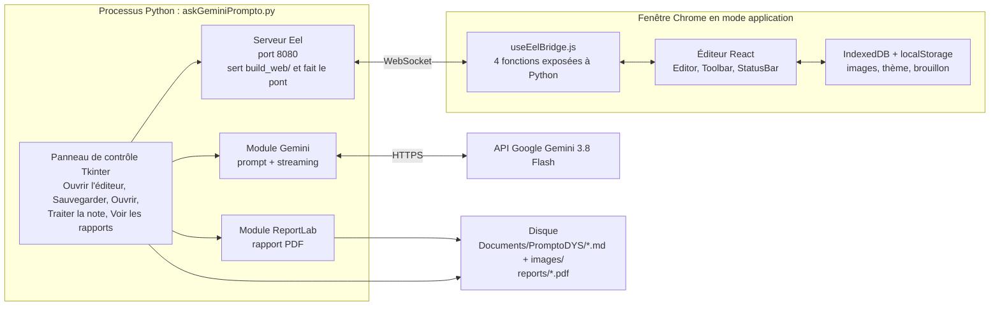
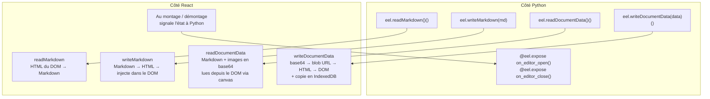
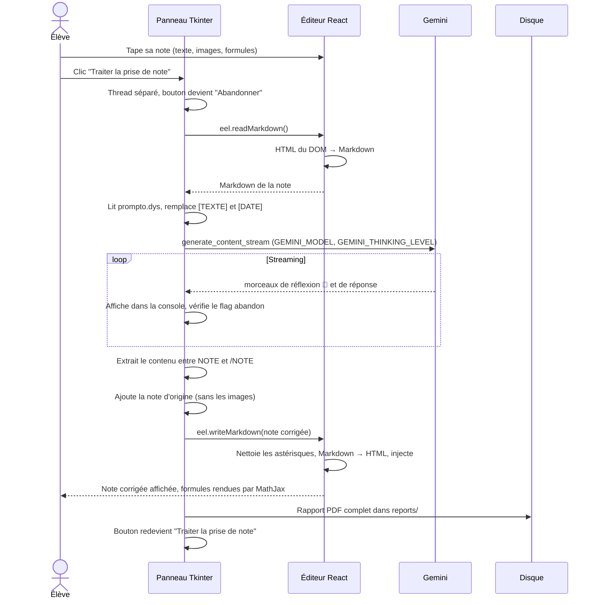
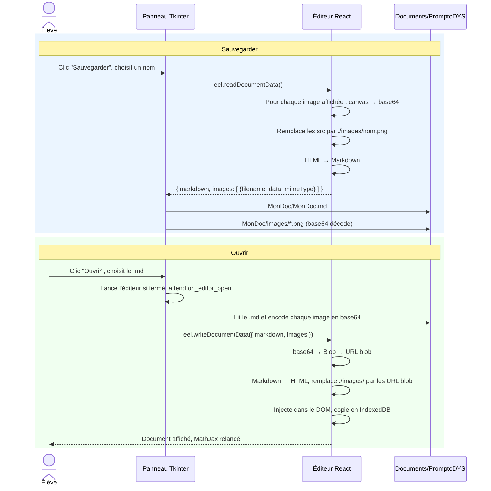
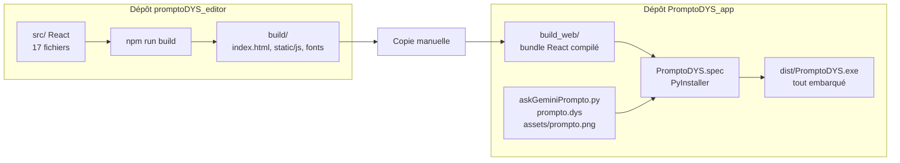

# Architecture et fonctionnement de PromptoDYS

> Document de référence pour comprendre comment les deux projets (application Python et éditeur React) coopèrent, du clic de l'élève jusqu'au rapport PDF.
>
> Dernière mise à jour : 19/10/2026. Les schémas sont en Mermaid et se rendent directement dans GitHub, VS Code et la plupart des visionneuses Markdown.

---

## Sommaire

1. [Les deux dépôts](#1-les-deux-dépôts)
2. [Les trois acteurs qui tournent en même temps](#2-les-trois-acteurs-qui-tournent-en-même-temps)
3. [Le pont Eel : quatre fonctions, un seul langage commun](#3-le-pont-eel--quatre-fonctions-un-seul-langage-commun)
4. [Le traitement IA de bout en bout](#4-le-traitement-ia-de-bout-en-bout)
5. [Sauvegarde et ouverture d'un document avec images](#5-sauvegarde-et-ouverture-dun-document-avec-images)
6. [La chaîne de fabrication : deux dépôts, un seul exécutable](#6-la-chaîne-de-fabrication--deux-dépôts-un-seul-exécutable)
7. [Fichiers clés](#7-fichiers-clés)
8. [Points d'attention](#8-points-dattention)

---

## 1. Les deux dépôts

PromptoDYS est composé de deux projets indépendants, hébergés sur deux dépôts GitHub distincts du même compte.

| Projet | Rôle | Dépôt | Dossier local |
|---|---|---|---|
| **PromptoDYS_app** | Application Python : panneau de contrôle, appel à Gemini, rapports PDF, sauvegarde sur disque. Contient le bundle React **compilé**. | https://github.com/lecinquiemejour-code/PromptoDYS_app | `PythonProjects/PromptoDYS` |
| **promptoDYS_editor** | Éditeur React accessible aux dyslexiques. Contient les **sources** React. | https://github.com/lecinquiemejour-code/promptoDYS_editor | `CascadeProjects/editor` |

L'application Python ne contient pas le code source de l'éditeur, seulement sa version compilée dans `build_web/`. Voir la section 6 pour la chaîne de fabrication.

---

## 2. Les trois acteurs qui tournent en même temps

Quand on lance PromptoDYS, un seul programme Python démarre, mais il fait vivre trois choses à la fois : une petite fenêtre de contrôle Tkinter, un mini serveur web Eel, et une fenêtre Chrome qui affiche l'éditeur React.

Python et l'éditeur ne partagent pas de mémoire : ils se parlent par un tuyau WebSocket que gère Eel.



**Le point clé :** l'éditeur ne connaît pas Gemini, et Python ne connaît pas le HTML de l'éditeur. Chacun reste dans son rôle, et le pont Eel ne transporte que du Markdown.

### Rôle de chaque acteur

- **Panneau Tkinter** ([askGeminiPrompto.py](../askGeminiPrompto.py), fonction `gui_control_panel`) : chef d'orchestre. Cinq boutons, une barre de statut, une console de logs. Chaque action longue tourne dans un thread séparé pour ne pas figer la fenêtre.
- **Serveur Eel** : démarré par `eel.init(build_web)` puis `eel.start(...)` quand on clique sur Ouvrir l'éditeur. Il sert les fichiers statiques de l'éditeur et maintient le WebSocket.
- **Éditeur React** : zone d'édition WYSIWYG, barre d'outils, thème DYS, lecture vocale, formules MathJax. Il fonctionne aussi seul dans un navigateur, sans Python.
- **Stockage navigateur** : les images insérées sont copiées en IndexedDB, le brouillon et le thème en localStorage. Cela survit à un rafraîchissement de page.

---

## 3. Le pont Eel : quatre fonctions, un seul langage commun

Le fichier `src/hooks/useEelBridge.js` de l'éditeur expose quatre fonctions que Python peut appeler comme si elles étaient locales. **Python parle toujours Markdown.** C'est l'éditeur qui convertit vers ou depuis son HTML interne.



| Fonction | Sens | Usage | Format échangé |
|---|---|---|---|
| `readMarkdown` | Python lit l'éditeur | Traitement IA | Markdown (texte seul) |
| `writeMarkdown` | Python écrit dans l'éditeur | Injection de la note corrigée | Markdown (texte seul) |
| `readDocumentData` | Python lit l'éditeur | Sauvegarde complète | `{ markdown, images: [{filename, data, mimeType}] }` |
| `writeDocumentData` | Python écrit dans l'éditeur | Ouverture complète | Même structure |
| `on_editor_open` / `on_editor_close` | React signale Python | État de l'éditeur, activation des boutons | Aucun paramètre |

### Règle technique importante

Eel ne sait pas attendre une promesse JavaScript. **Les fonctions exposées doivent être synchrones.** Une fonction `async` renvoie une promesse, que Python reçoit comme un dictionnaire vide. C'est la cause du bug corrigé le 19/02/2026 (voir [NOTE_POUR_DEV_FRONTEND.md](../NOTE_POUR_DEV_FRONTEND.md)).

Conséquence : pour la sauvegarde, les images sont lues directement dans les pixels affichés, via un `canvas`, plutôt que depuis IndexedDB qui est asynchrone.

### Convention Markdown des images

Dans le Markdown échangé, une image s'écrit avec ses attributs entre accolades :

```markdown
{width=300px id=a1b2c3d4-...}
```

- `./images/<filename>` : chemin relatif au dossier du document.
- `width` / `height` : dimensions choisies dans l'éditeur.
- `id` : identifiant interne IndexedDB. Python ne le génère pas et ne le modifie pas, il le préserve tel quel.

---

## 4. Le traitement IA de bout en bout

C'est le cœur du produit. Tout part du bouton **Traiter la prise de note**, et tout se termine par un PDF d'archive.



### Les étapes dans le code Python

La fonction `traitement_gemini()` de [askGeminiPrompto.py](../askGeminiPrompto.py) suit onze étapes numérotées dans ses logs :

1. Initialisation du client Gemini (clé lue dans `GeminiKey.txt`).
2. Lecture du Markdown de l'éditeur.
3. Lecture du template [prompto.dys](../prompto.dys).
4. Substitution de `[TEXTE]` et `[DATE]`.
5. Configuration : modèle `GEMINI_MODEL` (`gemini-3.8-flash`) et niveau de réflexion `GEMINI_THINKING_LEVEL` (`LOW`), deux constantes en tête du fichier.
6. Streaming de la réponse, avec vérification du flag d'abandon à chaque morceau.
7. Extraction du contenu entre `<NOTE>` et `</NOTE>`, puis ajout de la note d'origine sans les images.
8. Injection dans l'éditeur.
9. Bilan des tokens (entrée, sortie, réflexion).
10. Génération du rapport PDF avec ReportLab.
11. Ajout à l'historique de session.

### Le rôle de prompto.dys

Le fichier [prompto.dys](../prompto.dys) est le cerveau pédagogique. Il impose à Gemini :

- une structure en **sept sections** : titre, résumé, mots-clés, note corrigée, avertissement, doutes, questions. La note d'origine est ajoutée ensuite par Python, copie exacte sans les images ;
- une **fidélité au contenu** : aucune information supprimée ni ajoutée, les doutes sont signalés au lieu d'être corrigés ;
- **pas d'italique**, difficile à lire pour les dyslexiques ;
- des **titres colorés** en `#3399ff` ;
- les **balises `<NOTE>`** qui permettent à Python de séparer la note corrigée du débrief.

Si Gemini oublie les balises, Python injecte toute la réponse. C'est le cas dégradé prévu.

### Le rapport PDF

Généré par `generer_pdf_reportlab()`. Il contient le contenu original, les logs de traitement, le flux complet de réflexion et de réponse, la note finale, le débrief et les statistiques de tokens. Un parseur Markdown maison convertit le texte en paragraphes ReportLab, en supprimant les balises `<span>` et les émojis non supportés.

---

## 5. Sauvegarde et ouverture d'un document avec images

La convention choisie est celle de l'Arduino : **un dossier qui porte le nom du document**, contenant un fichier `.md` du même nom et un sous-dossier `images/`.

```
MonDocument/
├── MonDocument.md
└── images/
    ├── photo_20260212_143022_0.png
    └── schema_20260212_150530_1.png
```

Le dossier par défaut est `Documents\PromptoDYS` de l'utilisateur Windows.



Le résultat sur disque est volontairement **identique** à ce que produisent les boutons de sauvegarde internes à l'éditeur en mode navigateur. Un document sauvé par l'un s'ouvre avec l'autre.

Côté Python, les fonctions concernées sont `save_document()` et `load_document()` dans [askGeminiPrompto.py](../askGeminiPrompto.py). Le chemin du dernier document ouvert ou sauvé est mémorisé pour pré-remplir le dialogue suivant.

---

## 6. La chaîne de fabrication : deux dépôts, un seul exécutable

Les deux projets se rejoignent par une **copie manuelle du build** de l'éditeur dans l'application Python.



### Procédure quand l'éditeur change

1. Dans `CascadeProjects/editor` : modifier les sources, puis `npm run build`.
2. Copier le contenu de `build/` dans `PythonProjects/PromptoDYS/build_web/`.
3. Vérifier que `build_web/index.html` référence bien le nouveau bundle `main.<hash>.js`.
4. Commiter dans **les deux** dépôts.

### Procédure pour produire l'exécutable

```powershell
uv sync --locked
uv run pyinstaller --clean PromptoDYS.spec
```

Le résultat est `dist/PromptoDYS.exe`. Voir aussi [README_ANTIVIRUS.md](../README_ANTIVIRUS.md).

---

## 7. Fichiers clés

### Application Python (`PromptoDYS_app`)

| Fichier | Rôle |
|---|---|
| [askGeminiPrompto.py](../askGeminiPrompto.py) | Tout le code Python : GUI, pont Eel, Gemini, PDF, sauvegarde |
| [prompto.dys](../prompto.dys) | Template du prompt envoyé à Gemini |
| `GeminiKey.txt` | Clé API, **ignoré par git**, à créer depuis [.env.template](../.env.template) |
| [PromptoDYS.spec](../PromptoDYS.spec) | Configuration PyInstaller |
| `build_web/` | Éditeur React compilé, copié depuis le projet editor |
| `build_web/config.yaml` | Mode développeur de l'éditeur (lu au premier lancement seulement) |
| `reports/` | Rapports PDF générés, ignoré par git |

### Éditeur React (`promptoDYS_editor`)

| Fichier | Rôle |
|---|---|
| `src/hooks/useEelBridge.js` | Les quatre fonctions exposées à Python |
| `src/utils/markdownConverter.js` | Conversion HTML vers Markdown et retour |
| `src/utils/imageStore.js` | Stockage des images en IndexedDB |
| `src/components/Editor.js` | Zone d'édition WYSIWYG, sélection images et formules |
| `src/components/Toolbar.js` | Barre d'outils, sauvegarde et ouverture en mode navigateur |
| `src/hooks/useThemeSettings.js` | Thème DYS : couleurs, police, interlignage, espacement |
| `src/hooks/useTextToSpeech.js` | Lecture vocale avec surlignage mot à mot |
| `src/hooks/useMathJax.js` | Rendu des formules et enrichissement `data-tex` pour la sauvegarde |
| `SPEC_EDITEUR_ET_BRIDGE_PYTHON.md` | Spécification du pont, côté éditeur |

---

## 8. Points d'attention

- **Clé API embarquée dans l'exécutable.** Le fichier spec inclut `GeminiKey.txt` dans l'exe. Toute personne qui possède l'exe peut extraire la clé. Ne jamais commiter un exe dans un dépôt, et révoquer toute clé qui aurait été diffusée.
- **Fonctions Eel synchrones uniquement.** Toute nouvelle fonction exposée à Python doit être synchrone (voir section 3).
- **Convertisseur Markdown à base d'expressions régulières.** Il gère les cas courants mais reste fragile sur le HTML imbriqué. C'est le point le plus sensible du pont, puisque tout ce que Gemini renvoie passe par là.
- **Mode développeur persistant.** Il est stocké dans le localStorage de Chrome et prime sur `config.yaml`. Une fois activé, modifier le YAML ne suffit plus pour le désactiver.
- **Images blob non persistantes.** En mode desktop, une image affichée via une URL blob ne survit pas à un redémarrage de Chrome. La sauvegarde Python compense en lisant les pixels dans le DOM.
- **Copie manuelle du build.** Rien ne garantit automatiquement que `build_web/` est à jour des sources de l'éditeur. Comparer les empreintes des fichiers `main.<hash>.js` en cas de doute.
- **Pas de tests automatisés** dans aucun des deux projets.
