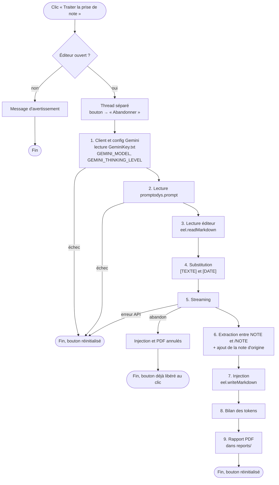
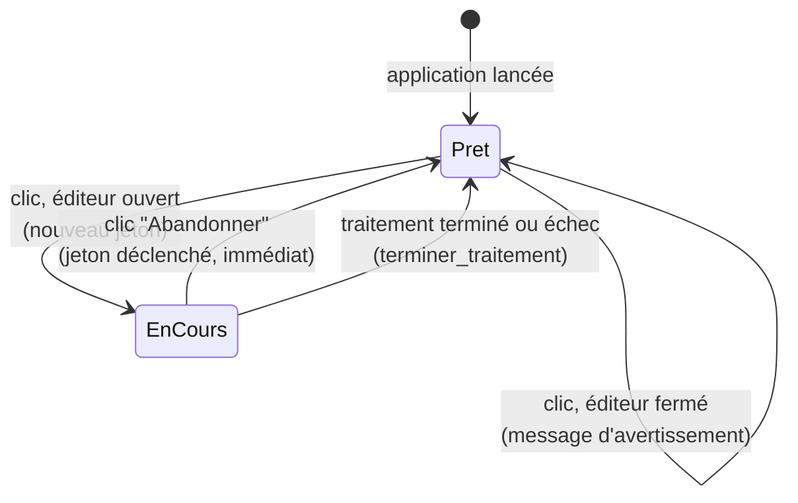
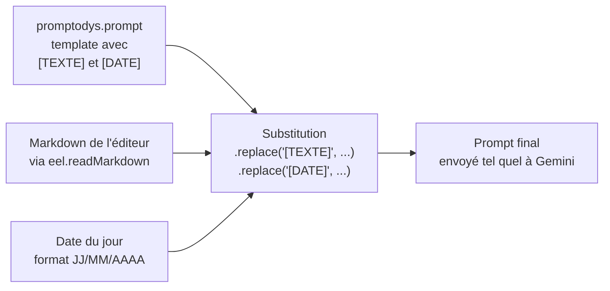
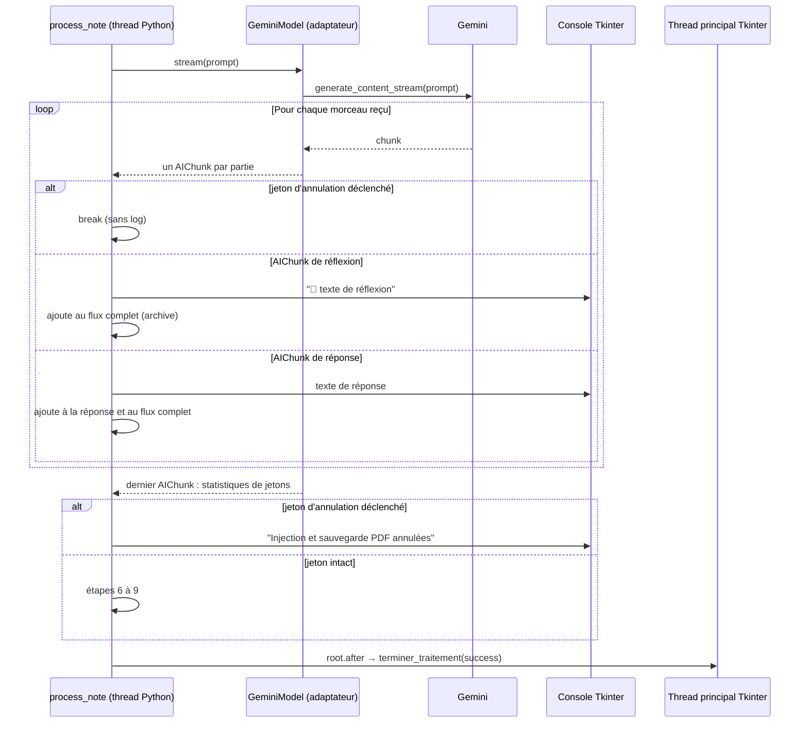
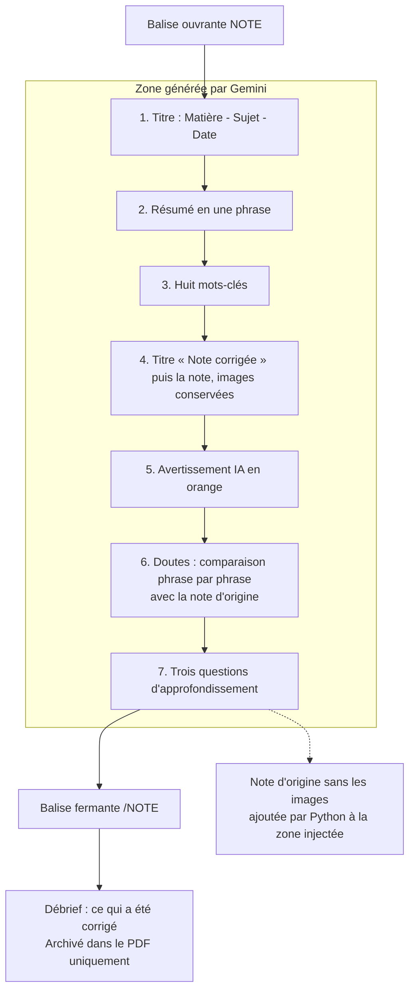
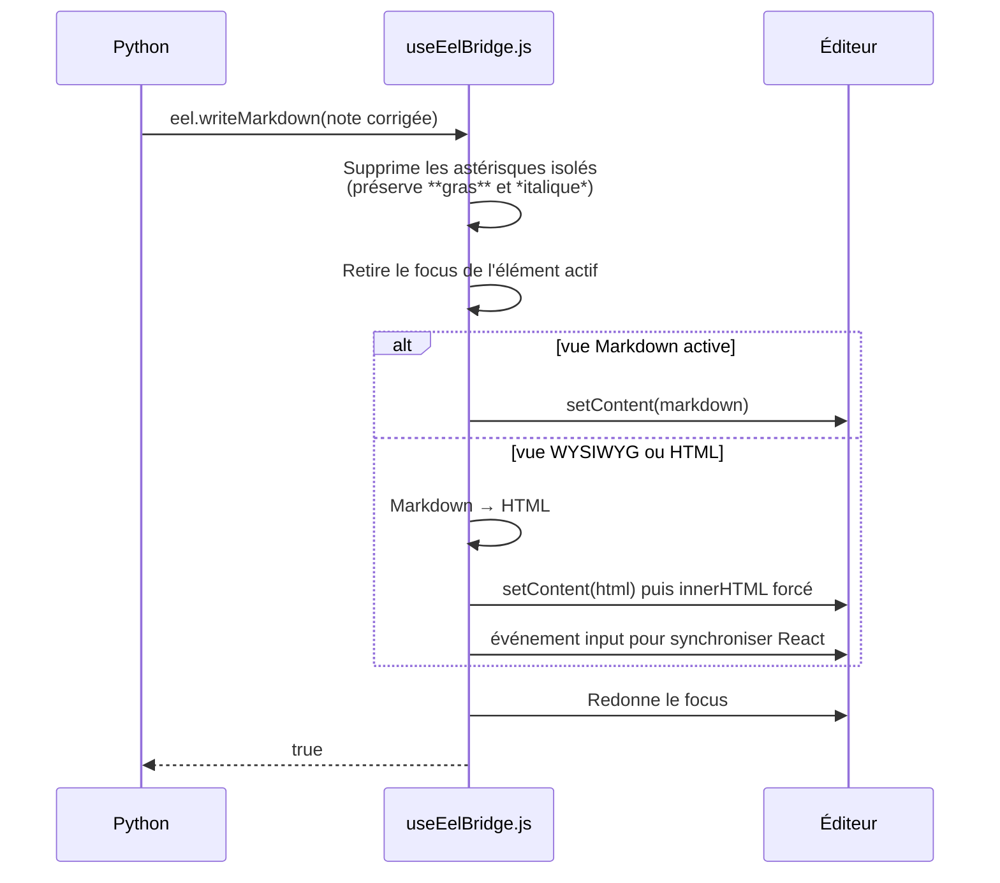
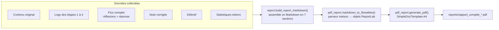
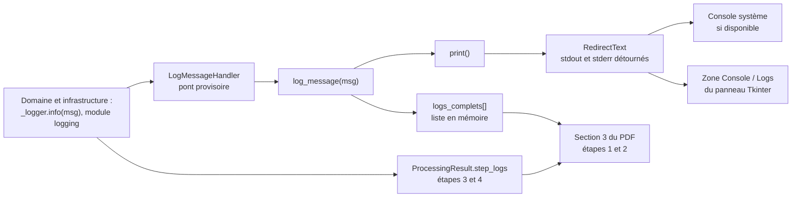

# Workflow de traitement par Gemini

> Document de référence sur le cœur de PromptoDYS : comment une note d'élève part de l'éditeur, est corrigée par Google Gemini, revient dans l'éditeur et finit archivée en PDF.
>
> Dernière mise à jour : 03/11/2026. Code concerné : le cas d'usage `process_note()` de [promptodys/domain/processing.py](../promptodys/domain/processing.py) et les règles de [promptodys/domain/note.py](../promptodys/domain/note.py), appelés par `traitement_gemini()` dans [askGeminiPrompto.py](../askGeminiPrompto.py), les adaptateurs de [promptodys/infrastructure/](../promptodys/infrastructure/), et le template [promptodys.prompt](../promptodys.prompt). Pour la vue d'ensemble des deux projets, voir [ARCHITECTURE.md](ARCHITECTURE.md).

---

## Sommaire

1. [Vue d'ensemble en un schéma](#1-vue-densemble-en-un-schéma)
2. [Déclenchement et cycle de vie du bouton](#2-déclenchement-et-cycle-de-vie-du-bouton)
3. [Construction du prompt](#3-construction-du-prompt)
4. [Paramètres envoyés à Gemini](#4-paramètres-envoyés-à-gemini)
5. [Le streaming et l'abandon](#5-le-streaming-et-labandon)
6. [Anatomie de la réponse attendue](#6-anatomie-de-la-réponse-attendue)
7. [Extraction, nettoyage et injection](#7-extraction-nettoyage-et-injection)
8. [Statistiques de tokens](#8-statistiques-de-tokens)
9. [Le rapport PDF](#9-le-rapport-pdf)
10. [Gestion des erreurs](#10-gestion-des-erreurs)
11. [Capture des logs](#11-capture-des-logs)
12. [Modifier le comportement de l'IA](#12-modifier-le-comportement-de-lia)

---

## 1. Vue d'ensemble en un schéma

Le traitement suit neuf étapes numérotées, visibles telles quelles dans les logs de la console. Chaque étape écrit un message préfixé `ÉTAPE n`.

Le code est réparti en deux niveaux :

- **`traitement_gemini()`** ([askGeminiPrompto.py](../askGeminiPrompto.py)) fait ce qui dépend de l'infrastructure : étapes 1 (client Gemini, [gemini_model.py](../promptodys/infrastructure/gemini_model.py)), 2 (lecture de `promptodys.prompt`, [config.py](../promptodys/infrastructure/config.py)) et 9 (rapport PDF, [pdf_report.py](../promptodys/infrastructure/pdf_report.py)).
- **`process_note()`** ([promptodys/domain/processing.py](../promptodys/domain/processing.py)), le cas d'usage du domaine, fait les étapes 3 à 8. Il ne connaît ni Eel, ni Gemini, ni Tkinter : il reçoit l'éditeur et le modèle d'IA par leurs ports (`ports.Editor`, `ports.AIModel`), et renvoie un `ProcessingResult` dont le statut vaut `COMPLETED`, `FAILED` ou `CANCELLED`.



---

## 2. Déclenchement et cycle de vie du bouton

Le bouton **Traiter la prise de note** a deux rôles selon l'état : lancer le traitement, ou l'abandonner s'il est en cours. L'état repose sur un jeton d'annulation (`threading.Event`) propre à chaque traitement.

| Élément | Rôle |
|---|---|
| `annulation` | Jeton créé à chaque lancement et passé à `traitement_gemini(annulation)`. Le thread de traitement ne lit que celui-là |
| `annulation_en_cours` | Variable globale : jeton du traitement en cours, `None` s'il n'y en a pas. Lue et modifiée uniquement par le thread principal |
| `terminer_traitement(success)` | Fin du traitement, exécutée sur le thread principal : remet le bouton à zéro et affiche « terminé » ou « échec » |



**Pourquoi un thread séparé :** Tkinter fige la fenêtre si une opération longue tourne dans la boucle principale. Le traitement s'exécute donc dans un thread, et toute mise à jour de l'interface passe par `root.after(0, ...)` pour revenir sur le thread principal. Le thread de traitement ne modifie aucune variable d'état : il confie la fin du traitement à `terminer_traitement`.

**L'abandon immédiat :** un thread qui attend une réponse de Gemini ne peut pas être interrompu. Au clic sur « Abandonner », le thread principal déclenche donc le jeton du traitement, remet `annulation_en_cours` à `None` et libère le bouton sans attendre le thread. Si ce thread se réveille plus tard, il voit son jeton déclenché et s'arrête sans injecter dans l'éditeur ni écrire de PDF. À sa fin, `terminer_traitement` constate qu'il n'est plus le traitement en cours et ne touche pas à l'interface, même si un nouveau traitement a été lancé entre-temps.

**Limite :** si la connexion meurt sans prévenir, le thread abandonné reste bloqué jusqu'à la fermeture de l'application. Il est `daemon`, inactif, et n'écrit plus rien.

---

## 3. Construction du prompt

Le prompt envoyé à Gemini n'est pas écrit dans le code Python. Il est lu dans le fichier [promptodys.prompt](../promptodys.prompt), un fichier texte modifiable sans toucher au code. En développement, il est lu à la racine du dépôt. L'exécutable lit uniquement la copie embarquée lors du build (`sys._MEIPASS`) : un fichier placé à côté de l'exe est ignoré. Ce dossier est la constante `config.RESOURCES_DIR`.



### Structure de promptodys.prompt

Le fichier se lit en cinq blocs :

1. **Configuration** : le rôle de l'assistant, dédié à un apprenant avec troubles DYS, bienveillant et pédagogique.
2. **Instructions** : analyser, corriger l'orthographe et la grammaire, reformuler et réorganiser (fragments transformés en phrases, listes mélangées séparées par catégories, définitions rattachées à leur terme), ajouter des sous-parties, mettre en forme en Markdown, vérifier la syntaxe.
3. **Fidélité au contenu** : conserver toutes les informations de la note (faits, chiffres, noms, exemples), ne pas en ajouter, et signaler une information douteuse dans la section Doutes au lieu de la corriger. La règle porte sur le fond : la reformulation reste obligatoire.
4. **Matière et titre** : liste fermée des matières du collège. Gemini doit en choisir une, créer un titre et s'appuyer sur son expertise de la matière pour interpréter la note.
5. **Format de réponse et structure** : les contraintes de forme et les sept sections attendues (voir section 6).

Puis vient la zone de substitution :

```
## 📄 Texte à Traiter
Date de la prise de note : [DATE]
[TEXTE]
```

### Contrôle avant envoi

La fonction `config.read_prompt_template()` vérifie que la balise `[TEXTE]` est présente. La balise est déclarée une seule fois, dans le domaine (`note.TEXT_PLACEHOLDER`), et sert aussi à la substitution. Si elle manque, le traitement s'arrête avec un message d'erreur, car la note ne pourrait pas être insérée. La balise `[DATE]` n'est pas contrôlée : si elle manque, la date n'apparaît simplement pas.

---

## 4. Paramètres envoyés à Gemini

Les deux réglages principaux sont des constantes en tête de [promptodys/infrastructure/config.py](../promptodys/infrastructure/config.py) : `GEMINI_MODEL` et `GEMINI_THINKING_LEVEL`.

| Paramètre | Valeur | Pourquoi |
|---|---|---|
| Modèle | `GEMINI_MODEL` = `gemini-3.8-flash` | Interprète bien l'écriture phonétique des notes DYS, pour un coût proche de l'ancien Gemini 2.5 Flash |
| `thinking_level` | `GEMINI_THINKING_LEVEL` = `LOW` | Niveau de réflexion le plus économe accepté par 3.8 Flash, suffisant pour une note de collège |
| `include_thoughts` | `True` | Les résumés de réflexion sont renvoyés dans le flux, affichés avec le préfixe 💭 et archivés dans le PDF |
| Mode d'appel | `generate_content_stream` | Streaming : les morceaux arrivent au fil de l'eau, ce qui permet l'affichage en direct et l'abandon |

> **Paramètres retirés avec Gemini 3**
> - `temperature` : ignorée par les modèles Gemini 3.x. Google déconseille de la baisser sous 1.0 (risque de boucles et de qualité dégradée). La stabilité des corrections repose désormais sur la clarté du prompt.
> - `thinking_budget` : remplacé par `thinking_level`. Ce dernier est un niveau relatif (`LOW`, `MEDIUM`, `HIGH`), pas un plafond de tokens : en `LOW`, le modèle décide lui-même s'il réfléchit, et sur une note de collège il ne le fait généralement pas.
> - `max_output_tokens` : non renseigné, donc sans plafond. S'il est fixé, il inclut les tokens de réflexion : une valeur trop basse tronquerait la note avant la balise `</NOTE>`.

**Pourquoi `LOW` :** mesures sur une même note de sciences, avec le prompt actuel.

| Configuration | Réflexion | Total tokens | Qualité |
|---|---|---|---|
| Gemini 2.5 Flash, `thinking_budget=500` (ancienne version) | ≈ 500 | ≈ 3 340 | Référence |
| `gemini-3.8-flash`, `LOW` | 0 | ≈ 2 900 | Au moins équivalente |
| `gemini-3.8-flash`, `MEDIUM` | ≈ 2 000 à 3 000 | ≈ 5 500 | Gain sur la forme seulement |
| `gemini-3.5-flash-lite`, `HIGH` | ≈ 4 700 | ≈ 7 300 | Écarté : interprète mal l'écriture phonétique |

Les tokens de réflexion sont facturés au tarif des tokens de sortie, d'où l'intérêt de `LOW`.

Le client est créé à chaque traitement par `gemini_model.create_client()`, puis enveloppé dans l'adaptateur `GeminiModel`, qui porte la configuration et implémente le port `ports.AIModel`. La clé est lue par `config.read_api_key()` : première ligne de `GeminiKey.txt` qui n'est ni vide ni un commentaire `#`, avec tolérance du BOM ajouté par le Bloc-notes Windows. Si la clé est absente ou vaut encore la valeur du modèle `GeminiKey.txt.template`, le traitement s'arrête avec un message explicite. Seuls les 4 derniers caractères de la clé sont affichés dans les logs, car ces logs sont recopiés dans les rapports PDF.

---

## 5. Le streaming et l'abandon

Gemini renvoie sa réponse en morceaux. Chaque morceau contient une liste de parties, chacune marquée comme réflexion ou comme réponse. L'adaptateur `GeminiModel` convertit chaque partie en `AIChunk(text, thought)`, puis ajoute un dernier `AIChunk` qui porte seulement les statistiques de jetons. `process_note()` ne voit donc jamais les objets du SDK Gemini.



Deux accumulateurs distincts sont remplis pendant le streaming :

- **`answer`** : uniquement le texte de réponse, sans les réflexions. C'est lui qui sera analysé pour extraire la note.
- **`ai_stream`** : réflexions et réponse mélangées, dans l'ordre d'arrivée. C'est lui qui sera archivé dans le PDF (champ `ai_stream` du `ProcessingResult`).

**Si l'abandon est détecté**, au début d'un morceau ou à la sortie du flux (abandon pendant l'attente du dernier morceau), `process_note()` renvoie le statut `CANCELLED` et `traitement_gemini()` renvoie `False`, sans injecter ni écrire de PDF : le contenu de l'éditeur reste inchangé. Le bouton, lui, a déjà été libéré au moment du clic (voir [§2](#2-déclenchement-et-cycle-de-vie-du-bouton)). Dans les autres cas, succès ou erreur, `terminer_traitement` remet le bouton à l'état Prêt.

---

## 6. Anatomie de la réponse attendue

Le template impose à Gemini une réponse en deux zones : la note corrigée entre balises, puis un débrief libre après la balise fermante. La note d'origine ne fait pas partie de la réponse de Gemini : Python l'ajoute ensuite à la zone injectée (voir section 7).



### Contraintes de forme imposées par le template

| Contrainte | Raison DYS |
|---|---|
| Pas d'italique | Difficile à lire pour les dyslexiques |
| Titres de niveau `#`, `##` ou `###` seulement | Hiérarchie simple |
| Pas de titre `####` : sous-parties en ligne en gras ou en liste numérotée | Le parseur PDF ne gère que trois niveaux, et la note garde une hiérarchie simple |
| Titres colorés en `#3399ff` via une balise `<span>` | Repérage visuel rapide |
| Titre « Note corrigée » toujours présent en tête de la section 4 | Repère fixe d'une note à l'autre |
| Séparateurs horizontaux `---` entre blocs | Délimitation claire des idées |
| Chaque titre, élément de liste et `---` sur sa propre ligne, une seule ligne vide entre deux blocs, pas de `<br>` ni `<hr>` | Note aérée sans paragraphes éclatés, Markdown valide |
| Formules en `$...$` | Rendu par MathJax dans l'éditeur |
| Images replacées à l'identique, même URL, même position | Les images ne transitent pas par Gemini, seul leur lien Markdown y passe |

---

## 7. Extraction, nettoyage et injection

### Extraction

Les règles d'extraction sont des fonctions pures de [promptodys/domain/note.py](../promptodys/domain/note.py).

`extract_note_content()` cherche la première balise `<NOTE>` et la première balise `</NOTE>` dans la réponse, et renvoie ce qui est entre les deux.

**Cas dégradé :** si l'une des balises manque, toute la réponse est renvoyée, avec un avertissement dans les logs. L'élève voit alors la note corrigée et le débrief ensemble dans l'éditeur. Ce n'est pas bloquant.

`extract_correction_debrief()` renvoie tout ce qui suit `</NOTE>`, ou une chaîne vide si la balise manque.

### Ajout de la note d'origine

`append_original_note()` complète la note extraite avec la note de l'élève, telle qu'elle a été lue dans l'éditeur à l'étape 3 :

1. Les images sont retirées : liens Markdown de l'éditeur (`{width=300px id=...}`) et balises ``.
2. Les suites de lignes vides sont réduites à une seule.
3. Un éventuel séparateur `---` en fin de note corrigée est retiré, pour ne pas le doubler.
4. La note d'origine est ajoutée après un séparateur, sous un titre `### Note d'origine` coloré en `#3399ff`.

Si la note corrigée est vide, rien n'est ajouté, et l'étape 7 signale qu'il n'y a aucun contenu à injecter.

**Pourquoi côté Python :** quand Gemini recopiait lui-même la note d'origine, il payait chaque token de cette copie au tarif de sortie, le plus cher, et pouvait la modifier par erreur. L'ajout par Python donne une copie exacte et réduit les tokens de sortie d'environ 27 %, soit environ 13 % du total des tokens, sur la note de test. Le gain dépend de la longueur de la note d'origine : plus elle est longue, plus l'économie est importante.

### Nettoyage des marqueurs `__BOLD_n__`

Le convertisseur Markdown de l'éditeur protège temporairement le gras avec des marqueurs `__BOLD_0__`, `__BOLD_1__`, etc. Il arrive que Gemini voie ces marqueurs dans la note d'origine et les reproduise. Côté Python, `replace_bold_markers()` les remplace par des séparateurs `---`. Elle est appelée par `extract_note_content()` et par le générateur PDF (`nettoyer_html_tags()`), qui indiquent chacun dans un log combien de marqueurs ont été remplacés.

### Injection



Côté Python, l'adaptateur `EelEditor.write_markdown()` appelle la fonction JavaScript `writeMarkdown` et ne vérifie que l'absence d'exception. Un retour `None` du JavaScript est considéré comme un succès.

---

## 8. Statistiques de tokens

Le dernier morceau reçu de Gemini porte les métadonnées d'usage. L'adaptateur `GeminiModel` en extrait quatre valeurs et les transmet dans un dernier `AIChunk` (champ `usage`). `process_note()` les affiche à l'étape 8 et les renvoie dans le `ProcessingResult` :

| Clé | Signification |
|---|---|
| `input` | Tokens du prompt envoyé, template et note comprise |
| `output` | Tokens de la réponse, hors réflexions |
| `thinking` | Tokens consommés par la réflexion, facturés comme des tokens de sortie. Souvent absent en `LOW` : il s'affiche alors `None`, ce qui veut dire 0 |
| `total` | Somme des trois |

Ces statistiques servent à suivre le coût d'une correction. Elles sont affichées dans la console et écrites dans le PDF. Si Gemini n'en renvoie pas, l'étape 8 l'indique (« Statistiques non disponibles »).

---

## 9. Le rapport PDF

Chaque traitement réussi produit un PDF d'archive dans le dossier `reports/`, nommé `rapport_complet_AAAAMMJJ_HHMMSS.pdf`. Il n'y a pas de sauvegarde Markdown du rapport, le PDF est le seul format.



### Les sept sections du rapport

1. Métadonnées de la session : les quatre compteurs de tokens.
2. Contenu original de l'éditeur, en bloc indenté.
3. Log complet du traitement : les messages des étapes 1 à 4.
4. Streaming Gemini complet : réflexions et réponse dans l'ordre d'arrivée.
5. Contenu traité final : la note corrigée.
6. Débrief de la correction par l'IA.
7. Informations de session : modèle (`GEMINI_MODEL`), niveau de réflexion (`GEMINI_THINKING_LEVEL`), type de sauvegarde.

### Le parseur Markdown du PDF

ReportLab ne lit pas le Markdown. Un parseur ligne à ligne maison reconnaît les titres `#`, `##`, `###`, les séparateurs `---`, les puces `-` et `*`, les blocs de code entre triples accents graves, et le gras et l'italique en ligne. Il supprime au passage ce que ReportLab ne supporte pas : les balises `<span>` de couleur, une liste d'émojis, et il échappe les caractères `&`, `<` et `>`.

Si la génération du PDF échoue, le traitement n'est pas considéré comme raté : la note est déjà dans l'éditeur, seul l'archivage manque.

---

## 10. Gestion des erreurs

| Situation | Détection | Comportement |
|---|---|---|
| `GeminiKey.txt` absent | `FileNotFoundError` à l'étape 1 | Arrêt, message dans les logs, éditeur inchangé |
| Clé vide ou valeur du modèle `GeminiKey.txt.template` non remplacée | Étape 1 | Arrêt, message demandant de renseigner la clé |
| `promptodys.prompt` absent ou sans `[TEXTE]` | Étape 2 | Arrêt, message dans les logs |
| Éditeur vide | Pas d'erreur | Le prompt est envoyé avec une note vide, Gemini répond quand même |
| Erreur serveur Gemini (5xx) | `genai_errors.ServerError`, converti en `AIModelError` par `GeminiModel` | Arrêt, message, bouton réinitialisé |
| Erreur API Gemini (clé invalide, quota, 4xx) | `genai_errors.APIError`, converti en `AIModelError` par `GeminiModel` | Arrêt, message, bouton réinitialisé |
| Coupure réseau pendant le streaming | `Exception` générique | Arrêt, message, bouton réinitialisé |
| Abandon par l'utilisateur | Jeton d'annulation, vérifié à chaque morceau et à la sortie du flux | Bouton libéré au clic, injection et PDF annulés |
| Abandon alors que Gemini ne répond plus | Jeton d'annulation | Bouton libéré au clic sans attendre le thread. S'il se réveille, il s'arrête sans rien écrire ; une erreur de connexion survenue après l'abandon n'est pas loggée |
| Balises `<NOTE>` absentes | Test de présence | Réponse complète injectée, avertissement |
| Échec d'injection dans l'éditeur | Exception Eel | Message d'échec, le PDF est quand même généré |
| Échec de génération PDF | Exception ReportLab | Message, la note reste dans l'éditeur |

Hors abandon, c'est `terminer_traitement`, sur le thread principal, qui remet le bouton à l'état Prêt et affiche « ✅ Traitement IA terminé ! » ou « ❌ Échec du traitement IA (voir les logs) ». Aucune exception ne remonte jusqu'à Tkinter.

---

## 11. Capture des logs

Plusieurs mécanismes se superposent pour que rien ne se perde. Ils sont provisoires : R7 de [RECOMMANDATIONS.md](RECOMMANDATIONS.md) les remplacera par le module `logging` et ses handlers.



- **Le domaine et l'infrastructure** (`promptodys/`) journalisent avec le module standard `logging` (`_logger = logging.getLogger(__name__)`), sans connaître la console ni le rapport. Exception provisoire : les traces détaillées de `EelEditor` et `DiskDocumentStore` passent encore par `print()`, donc vont à la console sans entrer dans le rapport.
- **`LogMessageHandler`**, installé par `configure_logger()` au démarrage, renvoie chaque message du logger `promptodys` vers `log_message()`, message seul, sans niveau ni heure.
- **`log_message()`** écrit dans la console et ajoute à la liste `logs_complets`.
- **`RedirectText`** détourne `sys.stdout` et `sys.stderr` vers la zone de texte Tkinter, en gardant une copie vers la vraie console. Les exceptions non prévues apparaissent donc aussi dans l'interface.
- **`logs_complets`** et la console sont vidés au tout début de chaque traitement. Le PDF reçoit les logs de préparation : une copie de `logs_complets` prise après l'étape 2, puis les logs des étapes 3 et 4 renvoyés par `process_note()` dans `step_logs`. La section 3 du rapport contient donc la préparation, pas le streaming, qui a sa propre section.

---

## 12. Modifier le comportement de l'IA

### Changer les consignes pédagogiques

Éditer [promptodys.prompt](../promptodys.prompt). Aucune modification de code n'est nécessaire, mais il faut relancer le build pour que l'exécutable embarque la nouvelle version. Points à respecter :

- Garder la balise `[TEXTE]`, sinon le traitement refuse de démarrer.
- Garder `[DATE]` si le titre doit contenir la date.
- Garder la consigne d'encadrer la note avec `<NOTE>` et `</NOTE>`, sinon le débrief sera injecté dans l'éditeur avec la note.
- Ne pas demander la note d'origine dans le prompt : Python l'ajoute déjà (voir section 7), elle apparaîtrait en double.
- Chaque consigne ajoutée est envoyée à chaque traitement : quelques dizaines de tokens d'entrée par appel. Le modèle applique les consignes à la lettre, une consigne ambiguë ou contradictoire se voit tout de suite dans la mise en forme.
- Tester avec une note contenant une image et une formule, ce sont les deux cas où la mise en forme casse le plus facilement.

### Changer le modèle ou les paramètres

Il suffit de modifier les deux constantes en tête de [promptodys/infrastructure/config.py](../promptodys/infrastructure/config.py). Elles sont utilisées par la configuration de l'adaptateur `GeminiModel` (étape 1), l'appel de l'étape 5, les logs et le pied du rapport PDF.

```python
# Modèle Gemini utilisé (ex. "gemini-3.8-flash", "gemini-3.5-flash-lite")
GEMINI_MODEL = "gemini-3.8-flash"

# Niveau de réflexion Gemini 3.x
GEMINI_THINKING_LEVEL = types.ThinkingLevel.LOW
```

La configuration de `GeminiModel` en découle :

```python
self.generate_content_config = types.GenerateContentConfig(
    thinking_config=types.ThinkingConfig(
        thinking_level=config.GEMINI_THINKING_LEVEL,
        include_thoughts=True,
    ),
)
```

Points d'attention :

- Les niveaux acceptés dépendent du modèle : `gemini-3.8-flash` accepte `LOW`, `MEDIUM` et `HIGH`, mais refuse `MINIMAL` (erreur 400). `gemini-3.5-flash-lite` documente `MINIMAL`, `MEDIUM` et `HIGH`.
- `MEDIUM` et `HIGH` multiplient le coût par deux à trois, car la réflexion est facturée comme de la sortie (voir section 4).
- Ne pas réintroduire `temperature` ni `thinking_budget` : ils sont ignorés ou dépréciés sur Gemini 3, et `thinking_budget` ne peut pas être combiné avec `thinking_level`.
- Passer `include_thoughts` à `False` allège le flux et le PDF, mais fait perdre la trace du raisonnement. Le coût ne change pas.

### Changer le contenu du rapport PDF

Modifier `build_report_markdown()` ([promptodys/domain/report.py](../promptodys/domain/report.py)) pour les sections, et `markdown_to_flowables()` ([promptodys/infrastructure/pdf_report.py](../promptodys/infrastructure/pdf_report.py)) pour le rendu. Toute nouvelle syntaxe Markdown dans le rapport doit être ajoutée au parseur, sinon elle s'affiche en texte brut.
