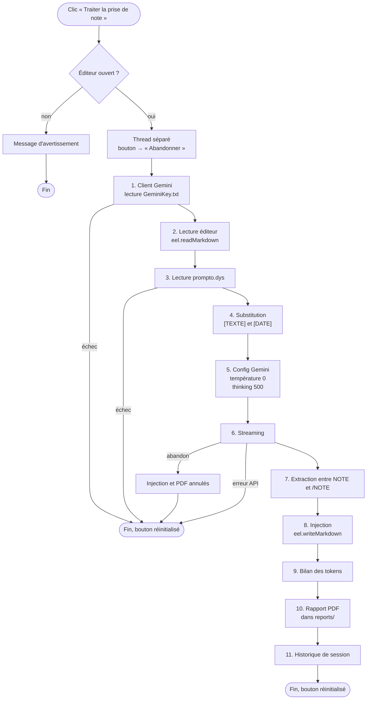
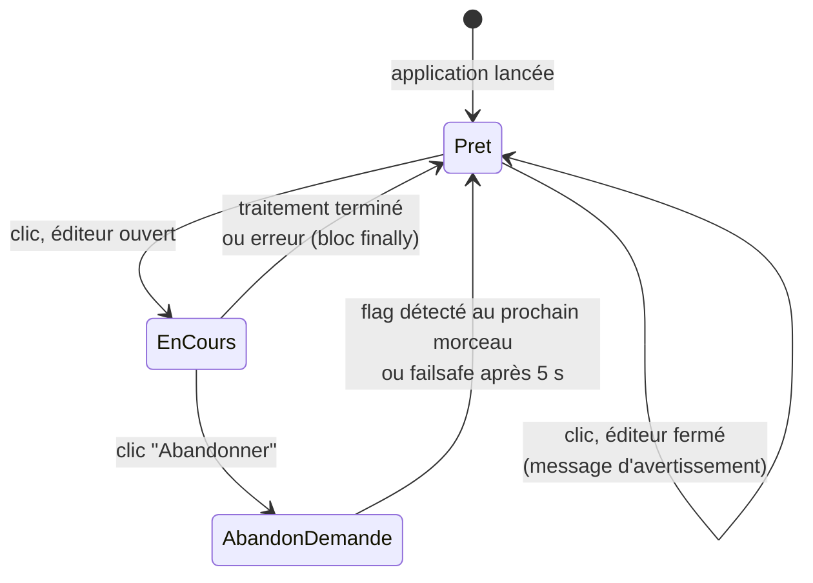
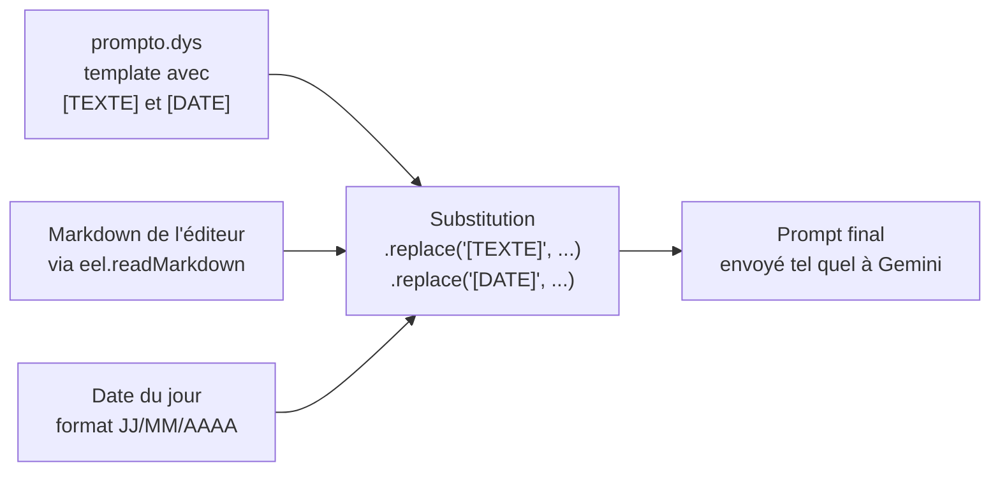
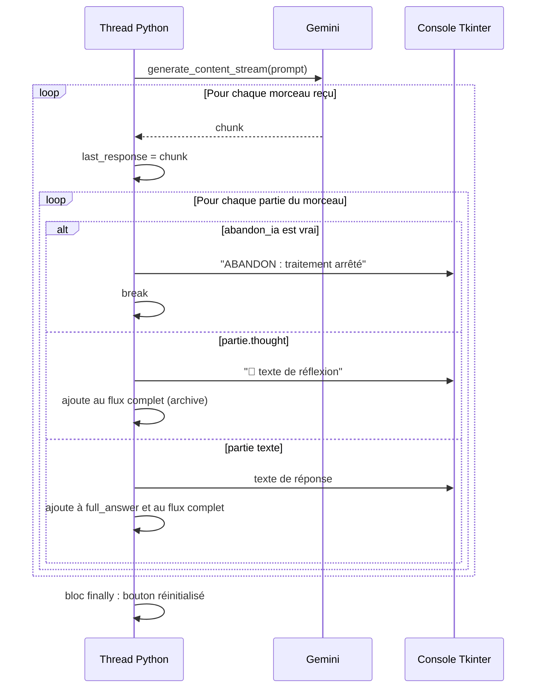
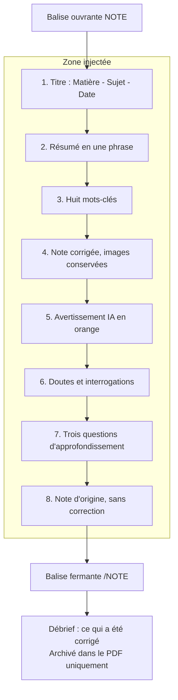
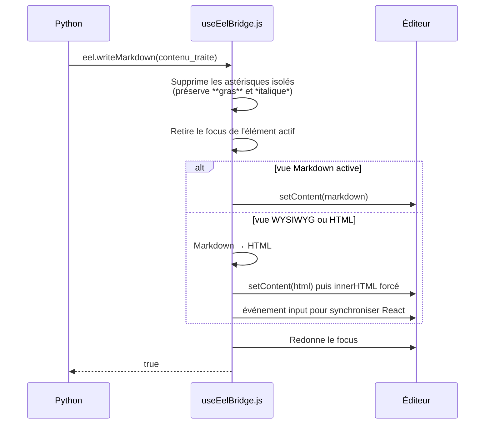
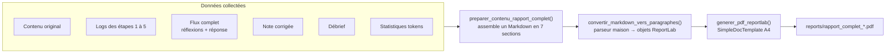
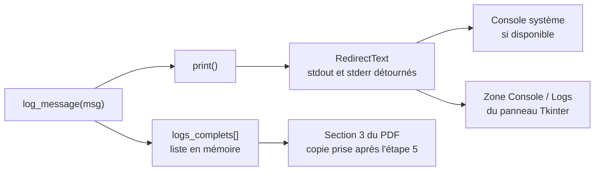

# Workflow de traitement par Gemini

> Document de référence sur le cœur de PromptoDYS : comment une note d'élève part de l'éditeur, est corrigée par Google Gemini, revient dans l'éditeur et finit archivée en PDF.
>
> Dernière mise à jour : 12/10/2026. Code concerné : fonction `traitement_gemini()` et ses fonctions auxiliaires dans [askGeminiPrompto.py](../askGeminiPrompto.py), template [prompto.dys](../prompto.dys). Pour la vue d'ensemble des deux projets, voir [ARCHITECTURE.md](ARCHITECTURE.md).

---

## Sommaire

1. [Vue d'ensemble en un schéma](#1-vue-densemble-en-un-schéma)
2. [Déclenchement et cycle de vie du bouton](#2-déclenchement-et-cycle-de-vie-du-bouton)
3. [Construction du prompt](#3-construction-du-prompt)
4. [Paramètres envoyés à Gemini](#4-paramètres-envoyés-à-gemini)
5. [Le streaming et l'abandon](#5-le-streaming-et-labandon)
6. [Anatomie de la réponse attendue](#6-anatomie-de-la-réponse-attendue)
7. [Extraction, nettoyage et injection](#7-extraction-nettoyage-et-injection)
8. [Statistiques de tokens](#8-statistiques-de-tokens)
9. [Le rapport PDF](#9-le-rapport-pdf)
10. [Gestion des erreurs](#10-gestion-des-erreurs)
11. [Capture des logs](#11-capture-des-logs)
12. [Modifier le comportement de l'IA](#12-modifier-le-comportement-de-lia)

---

## 1. Vue d'ensemble en un schéma

Le traitement suit onze étapes numérotées, visibles telles quelles dans les logs de la console. Chaque étape écrit un message préfixé `ÉTAPE n`.



---

## 2. Déclenchement et cycle de vie du bouton

Le bouton **Traiter la prise de note** a deux rôles selon l'état : lancer le traitement, ou l'abandonner s'il est en cours. Trois variables globales pilotent cet état.

| Variable | Rôle |
|---|---|
| `traitement_en_cours` | Vrai pendant toute la durée du traitement |
| `abandon_ia` | Mis à vrai par le bouton pour demander l'arrêt |
| `btn_ia_global` | Référence au bouton pour changer son texte depuis le thread |



**Pourquoi un thread séparé :** Tkinter fige la fenêtre si une opération longue tourne dans la boucle principale. Le traitement s'exécute donc dans un thread, et toute mise à jour de l'interface passe par `root.after(0, ...)` pour revenir sur le thread principal.

**Le failsafe :** si l'abandon est demandé mais que Gemini n'envoie plus de morceau pendant plusieurs secondes, le flag ne serait jamais lu. Un minuteur de 5 secondes force le retour du bouton à l'état Prêt quoi qu'il arrive.

---

## 3. Construction du prompt

Le prompt envoyé à Gemini n'est pas écrit dans le code Python. Il est lu dans le fichier [prompto.dys](../prompto.dys), un fichier texte modifiable sans toucher au programme.



### Structure de prompto.dys

Le fichier se lit en quatre blocs :

1. **Configuration** : le rôle de l'assistant, dédié à un apprenant avec troubles DYS, bienveillant et pédagogique.
2. **Instructions** : analyser, corriger l'orthographe et la grammaire, améliorer la structure, mettre en forme en Markdown, vérifier la syntaxe.
3. **Matière et titre** : liste fermée des matières du collège. Gemini doit en choisir une et créer un titre.
4. **Format de réponse et structure** : les contraintes de forme et les huit sections attendues (voir section 6).

Puis vient la zone de substitution :

```
## 📄 Texte à Traiter
Date de la prise de note : [DATE]
[TEXTE]
```

### Contrôle avant envoi

La fonction `lire_prompto_dys()` vérifie que la balise `[TEXTE]` est présente. Si elle manque, le traitement s'arrête avec un message d'erreur, car la note ne pourrait pas être insérée. La balise `[DATE]` n'est pas contrôlée : si elle manque, la date n'apparaît simplement pas.

---

## 4. Paramètres envoyés à Gemini

| Paramètre | Valeur | Pourquoi |
|---|---|---|
| Modèle | `gemini-3.8-flash` | Rapide et économique, suffisant pour de la correction de texte |
| `temperature` | `0.0` | Réponses les plus déterministes possible : une correction doit être stable, pas créative |
| `max_output_tokens` | `None` | Pas de limite, la note corrigée peut être longue avec ses huit sections |
| `thinking_budget` | `500` | Gemini réfléchit avant de répondre, mais avec un plafond pour limiter le coût et la latence |
| `include_thoughts` | `True` | Les réflexions sont renvoyées dans le flux, affichées avec le préfixe 💭 et archivées dans le PDF |
| Mode d'appel | `generate_content_stream` | Streaming : les morceaux arrivent au fil de l'eau, ce qui permet l'affichage en direct et l'abandon |

Le client est créé à chaque traitement par `init_gemini_client()`, qui lit la première ligne de `GeminiKey.txt`. Les dix premiers caractères de la clé sont affichés dans les logs pour vérification, jamais la clé complète.

---

## 5. Le streaming et l'abandon

Gemini renvoie sa réponse en morceaux. Chaque morceau contient une liste de parties, chacune marquée comme réflexion ou comme réponse.



Deux accumulateurs distincts sont remplis pendant le streaming :

- **`full_answer`** : uniquement le texte de réponse, sans les réflexions. C'est lui qui sera analysé pour extraire la note.
- **`streaming_gemini_complet`** : réflexions et réponse mélangées, dans l'ordre d'arrivée. C'est lui qui sera archivé dans le PDF.

**Si l'abandon est détecté**, la boucle sort immédiatement. L'injection et le PDF sont annulés, le contenu de l'éditeur reste inchangé. Le bloc `finally` garantit que le bouton revient à l'état Prêt dans tous les cas, abandon, succès ou erreur.

---

## 6. Anatomie de la réponse attendue

Le template impose à Gemini une réponse en deux zones : la note corrigée entre balises, puis un débrief libre après la balise fermante.



### Contraintes de forme imposées par le template

| Contrainte | Raison DYS |
|---|---|
| Pas d'italique | Difficile à lire pour les dyslexiques |
| Titres de niveau `#`, `##` ou `###` seulement | Hiérarchie simple |
| Titres colorés en `#3399ff` via une balise `<span>` | Repérage visuel rapide |
| Séparateurs horizontaux `---` entre blocs | Délimitation claire des idées |
| Pas de saut de ligne dans le Markdown de la note corrigée | Évite les paragraphes éclatés dans l'éditeur |
| Formules en `$...$` | Rendu par MathJax dans l'éditeur |
| Images replacées à l'identique, même URL, même position | Les images ne transitent pas par Gemini, seul leur lien Markdown y passe |

---

## 7. Extraction, nettoyage et injection

### Extraction

`extraire_contenu_note()` cherche la première balise `<NOTE>` et la première balise `</NOTE>` dans `full_answer`, et renvoie ce qui est entre les deux.

**Cas dégradé :** si l'une des balises manque, toute la réponse est renvoyée, avec un avertissement dans les logs. L'élève voit alors la note corrigée et le débrief ensemble dans l'éditeur. Ce n'est pas bloquant.

`extraire_debrief_correction()` renvoie tout ce qui suit `</NOTE>`, ou une chaîne vide si la balise manque.

### Nettoyage des marqueurs `__BOLD_n__`

Le convertisseur Markdown de l'éditeur protège temporairement le gras avec des marqueurs `__BOLD_0__`, `__BOLD_1__`, etc. Il arrive que Gemini voie ces marqueurs dans la note d'origine et les reproduise. Côté Python, `extraire_contenu_note()` et le générateur PDF les remplacent par des séparateurs `---`. Un message de log indique combien ont été remplacés.

### Injection



Côté Python, `set_markdown()` ne vérifie que l'absence d'exception. Un retour `None` du JavaScript est considéré comme un succès.

---

## 8. Statistiques de tokens

Le dernier morceau reçu, `last_response`, porte les métadonnées d'usage. Quatre valeurs sont extraites et affichées :

| Clé | Signification |
|---|---|
| `input` | Tokens du prompt envoyé, template et note comprise |
| `output` | Tokens de la réponse, hors réflexions |
| `thinking` | Tokens consommés par la réflexion, plafonnés par `thinking_budget` |
| `total` | Somme des trois |

Ces statistiques servent à suivre le coût d'une correction. Elles sont affichées dans la console, écrites dans le PDF et conservées dans l'historique de session.

---

## 9. Le rapport PDF

Chaque traitement réussi produit un PDF d'archive dans le dossier `reports/`, nommé `rapport_complet_AAAAMMJJ_HHMMSS.pdf`. Il n'y a pas de sauvegarde Markdown du rapport, le PDF est le seul format.



### Les sept sections du rapport

1. Métadonnées de la session : les quatre compteurs de tokens.
2. Contenu original de l'éditeur, en bloc indenté.
3. Log complet du traitement : les messages des étapes 1 à 5.
4. Streaming Gemini complet : réflexions et réponse dans l'ordre d'arrivée.
5. Contenu traité final : la note corrigée.
6. Débrief de la correction par l'IA.
7. Informations de session : modèle, mode thinking, type de sauvegarde.

### Le parseur Markdown du PDF

ReportLab ne lit pas le Markdown. Un parseur ligne à ligne maison reconnaît les titres `#`, `##`, `###`, les séparateurs `---`, les puces `-` et `*`, les blocs de code entre triples accents graves, et le gras et l'italique en ligne. Il supprime au passage ce que ReportLab ne supporte pas : les balises `<span>` de couleur, une liste d'émojis, et il échappe les caractères `&`, `<` et `>`.

Si la génération du PDF échoue, le traitement n'est pas considéré comme raté : la note est déjà dans l'éditeur, seul l'archivage manque.

---

## 10. Gestion des erreurs

| Situation | Détection | Comportement |
|---|---|---|
| `GeminiKey.txt` absent | `FileNotFoundError` à l'étape 1 | Arrêt, message dans les logs, éditeur inchangé |
| `prompto.dys` absent ou sans `[TEXTE]` | Étape 3 | Arrêt, message dans les logs |
| Éditeur vide | Pas d'erreur | Le prompt est envoyé avec une note vide, Gemini répond quand même |
| Erreur serveur Gemini (5xx) | `genai_errors.ServerError` | Arrêt, message, bouton réinitialisé |
| Erreur API Gemini (clé invalide, quota, 4xx) | `genai_errors.APIError` | Arrêt, message, bouton réinitialisé |
| Coupure réseau pendant le streaming | `Exception` générique | Arrêt, message, bouton réinitialisé |
| Abandon par l'utilisateur | Flag `abandon_ia` | Sortie de boucle, injection et PDF annulés |
| Balises `<NOTE>` absentes | Test de présence | Réponse complète injectée, avertissement |
| Échec d'injection dans l'éditeur | Exception Eel | Message d'échec, le PDF est quand même généré |
| Échec de génération PDF | Exception ReportLab | Message, la note reste dans l'éditeur |

Dans tous les cas, le bloc `finally` de l'étape 6 remet le bouton à l'état Prêt. Aucune exception ne remonte jusqu'à Tkinter.

---

## 11. Capture des logs

Trois mécanismes se superposent pour que rien ne se perde.



- **`log_message()`** écrit dans la console et ajoute à la liste `logs_complets`.
- **`RedirectText`** détourne `sys.stdout` et `sys.stderr` vers la zone de texte Tkinter, en gardant une copie vers la vraie console. Les exceptions non prévues apparaissent donc aussi dans l'interface.
- **`logs_complets`** est remis à zéro au début de chaque traitement. Une copie est prise après l'étape 5 pour le PDF : la section 3 du rapport contient donc la préparation, pas le streaming, qui a sa propre section.

Chaque traitement est aussi ajouté à `historique_llm`, une liste en mémoire contenant le prompt, la réponse complète, la note extraite et les statistiques. Cet historique n'est pas sauvegardé sur disque et disparaît à la fermeture de l'application.

---

## 12. Modifier le comportement de l'IA

### Changer les consignes pédagogiques

Éditer [prompto.dys](../prompto.dys). Aucune modification de code n'est nécessaire. Points à respecter :

- Garder la balise `[TEXTE]`, sinon le traitement refuse de démarrer.
- Garder `[DATE]` si le titre doit contenir la date.
- Garder la consigne d'encadrer la note avec `<NOTE>` et `</NOTE>`, sinon le débrief sera injecté dans l'éditeur avec la note.
- Tester avec une note contenant une image et une formule, ce sont les deux cas où la mise en forme casse le plus facilement.

### Changer le modèle ou les paramètres

Dans `traitement_gemini()`, étape 5 et appel de l'étape 6 :

```python
config = types.GenerateContentConfig(
    temperature=0.0,
    max_output_tokens=None
)
config.thinking_config = types.ThinkingConfig(
    thinking_budget=500,
    include_thoughts=True
)
...
client.models.generate_content_stream(
    model="gemini-3.8-flash",
    contents=prompt_final,
    config=config
)
```

Augmenter `thinking_budget` améliore parfois la qualité sur les notes longues, au prix du temps et du coût. Passer `include_thoughts` à `False` allège le flux et le PDF, mais fait perdre la trace du raisonnement.

### Changer le contenu du rapport PDF

Modifier `preparer_contenu_rapport_complet()` pour les sections, et `convertir_markdown_vers_paragraphes()` pour le rendu. Toute nouvelle syntaxe Markdown dans le rapport doit être ajoutée au parseur, sinon elle s'affiche en texte brut.
